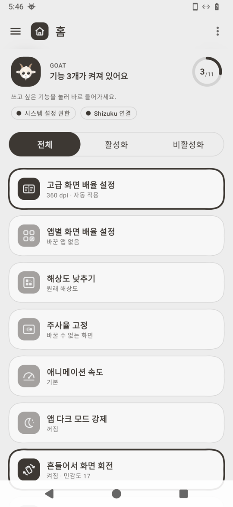
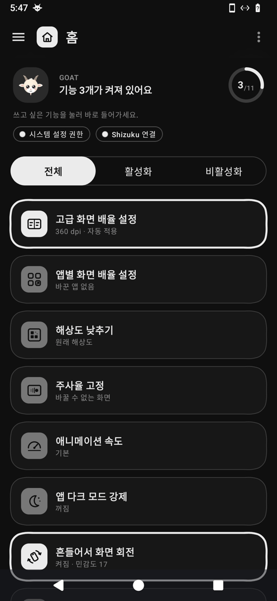
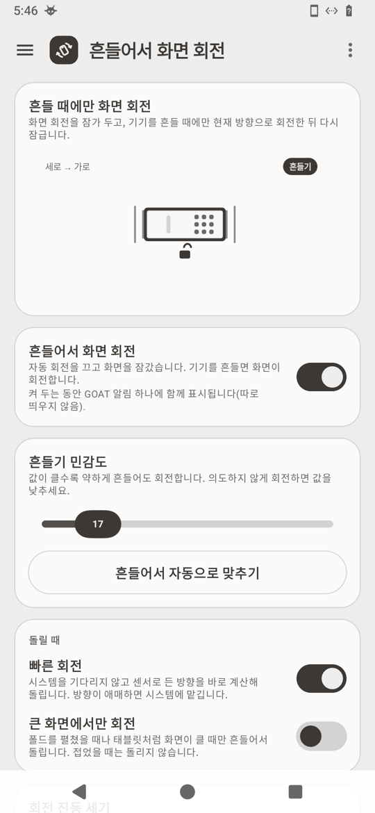
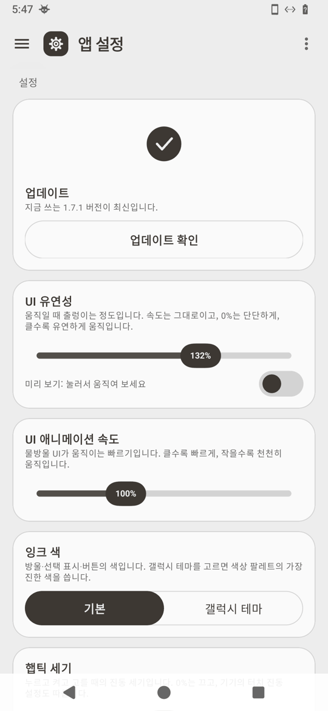

# GOAT

[🇺🇸 English](README.md) · **🇰🇷 한국어**

**Galaxy Optimization Advanced Tool** — 갤럭시를 더 편하게 쓰게 해 주는 도구 모음입니다.

갤럭시 기본 설정에는 없거나, 원래는 PC에서 명령어를 입력해야 바꿀 수 있는 설정을 앱 안에서 버튼과 스위치로 바꿀 수 있습니다. 루팅은 필요 없고, 바꾼 설정은 다시 켜도 그대로 유지됩니다. 무료이며 광고가 없습니다.

<p align="center">
  
  
  
  
</p>

## 이런 걸 할 수 있어요

| 기능 | 하는 일 | 필요한 것 |
|---|---|---|
| **고급 화면 배율** | 폴드의 바깥 화면과 안쪽 화면에서 글자·아이콘이 같은 크기로 보이게 맞춥니다. 접었다 펴도, 다시 켜도 그대로입니다. 두 화면을 아예 같은 값으로 쓸 수도 있습니다. | 처음 한 번 권한 |
| **앱별 화면 배율** | 앱마다 화면 크기를 따로 키우거나 줄입니다. 알림창에서 지금 앱 크기를 바로 바꿀 수도 있습니다. | One UI 9 이상, Shizuku |
| **해상도 낮추기** | 글자 크기는 그대로 두고 해상도만 낮춰 배터리를 아낍니다. 15초 안에 '유지'를 누르지 않으면 원래대로 돌아옵니다. | 처음 한 번 권한(폴드 제외) |
| **주사율 고정** | 화면을 항상 가장 부드럽게(예: 120Hz) 또는 배터리 절약(60Hz)으로 고정합니다. | Shizuku |
| **애니메이션 속도** | 앱을 열고 닫는 움직임을 더 빠르게(또는 끄기) 바꿉니다. | 처음 한 번 권한 |
| **강제 다크 모드** | 다크 모드를 지원하지 않는 앱도 어둡게 보이게 합니다. | Shizuku |
| **상태 표시줄** | 맨 위 상태 표시줄을 통째로 숨기거나, 알람·진동·블루투스 같은 아이콘만 골라 숨깁니다. | 처음 한 번 권한, 숨기기는 Shizuku |
| **흔들어서 화면 회전** | 평소에는 회전을 잠가 두고, 원하는 방향으로 든 채 흔들 때만 돌립니다. | 처음 한 번 권한 |
| **하단 제스처 바 3회 터치로 회전 고정** | 하단 바 가운데를 3회 터치하여 자동 회전 전환 또는 한 번 회전 후 고정을 실행합니다. 인식 폭·높이와 영역 표시를 조절할 수 있습니다. | 다른 앱 위에 표시 + 시스템 설정 변경 |
| **볼륨 버튼 회전** | 화면을 돌리면 볼륨 버튼의 올리기·내리기도 방향에 맞게 바뀝니다. | 처음 한 번 권한 |
| **플렉스 모드** | Galaxy Z Fold8처럼 반쯤 접힌 상태를 알려 주지 않는 폴드에서도, 노트북처럼 세우면 유튜브·카메라·갤러리가 위아래로 나뉜 화면이 됩니다. | 폴드, Shizuku |
| **카메라 촬영음 끄기** | 국내 갤럭시의 강제 촬영음을 끄고, 무음·진동 모드를 따르게 합니다. | Shizuku |
| **기본 앱 정리** | 쓰지 않는 기본 앱을 지우지 않고 꺼 둡니다. 언제든 다시 켤 수 있습니다. | Shizuku |
| **GOS 끄기** | 게임 성능을 제한하는 게임 최적화 서비스를 끕니다. | Shizuku |
| **잠자기 모드 끄기** | 화면이 꺼진 동안 알림이 늦게 오는 것을 막습니다(배터리는 더 씁니다). | Shizuku |
| **비행기 모드 무선 유지** | 비행기 모드를 켜도 와이파이·블루투스·NFC 중 고른 것은 그대로 둡니다. | 처음 한 번 권한 |
| **클립보드·TXT 공유** | 복사한 글이나 공유한 글을 TXT 파일로 바꿔 다른 앱에 보냅니다. | 없음 |
| **사용 통계** | 하루에 화면을 얼마나 켰는지, 어떤 앱을 많이 열었는지 보여 줍니다. 기록은 폰 밖으로 나가지 않습니다. | 사용 기록 접근 |

화면 언어는 한국어와 영어를 지원합니다. 앱 설정 → 언어에서 바꿀 수 있습니다.

제스처 바 실험 모드는 일반 앱 오버레이와 사용자가 허용하는 시스템 설정 변경 권한으로 동작해요. 접근성·특권 설정 권한·실행 중인 ADB/시주쿠 연결은 필요 없어요. 탭 안에 권한 설정 버튼과 폭·높이 조절, 영역 표시가 있어요. Android가 외부 설치 앱의 오버레이에 제한된 설정 확인을 요구할 수는 있어요. [설정 방법과 검증 기록](docs/gesture-bar-minimum-permissions.md)을 확인해 주세요.


## 시작하기

1. [Releases](../../releases/latest)에서 최신 `GOAT-x.x.x.apk`를 내려받아 설치합니다. 처음이라면 '출처를 알 수 없는 앱 설치'를 허용해야 합니다.
2. 앱을 처음 열면 **권한 설정 안내**가 나옵니다. 화면을 따라 하면 됩니다.
   - **PC 없이(추천):** 무료 앱 [Shizuku](https://shizuku.rikka.app/)를 깔고 안내대로 연결합니다. Wi-Fi가 필요합니다. 연결이 끊기면 GOAT가 알림으로 알려 주고, 알림의 [다시 연결]로 쉽게 다시 연결할 수 있습니다.
   - **PC로:** 안내에 나오는 명령을 PC에서 한 번만 실행합니다.
     ```bash
     adb shell pm grant com.labok.goat android.permission.WRITE_SECURE_SETTINGS
     ```
3. 쓰고 싶은 기능을 홈이나 왼쪽 메뉴(☰)에서 골라 켭니다.

업데이트는 앱이 알아서 확인합니다. 새 버전이 나오면 홈 맨 위에 [지금 업데이트]가 뜹니다. 앱을 지우고 다시 깔면 권한도 사라지니, 업데이트할 때는 지우지 말고 그대로 설치하세요.

## 자주 묻는 질문

**안전한가요?**
GOAT는 갤럭시가 원래 가지고 있는 설정 값을 바꿀 뿐이고, 시스템 파일을 고치지 않습니다. 바꾼 것은 각 기능의 [처음대로]나 ⋮ 메뉴의 초기화로 되돌릴 수 있습니다.

**화면 크기가 이상해졌어요. 되돌리려면?**
고급 화면 배율 화면의 ⋮ 메뉴 → 초기화 → 기본 DPI로 복원을 누르세요. 앱을 열 수 없다면 PC에서 `adb shell wm density reset`을 실행하면 됩니다.

**개인정보를 가져가나요?**
아니요. 사용 기록과 설정은 폰 안에만 있습니다. 문제를 신고할 때만, 직접 고른 진단 파일이 메일에 첨부됩니다.

**문제가 생기면?**
앱의 ⋮ 메뉴 → 문제 신고를 누르면 진단 파일이 첨부된 메일이 바로 만들어집니다.

## 바뀐 점

버전마다 바뀐 내용은 [변경 기록(CHANGELOG.md)](CHANGELOG.md)에 있습니다.

## 개발자용

- 구조: 공통 모듈 `:core`와 기능별 모듈 `:feature:*`(화면 크기·앱별 배율·회전·플렉스 등 17개), 이를 조립하는 `:app`으로 나뉩니다. 기능 모듈은 `:core`에만 기대며, 빌드 때 검사(WiringTest)가 이를 확인합니다.
- 빌드: `./build-apk.sh --release`(단위 테스트 포함). 문구는 `core/src/main/res/values`(영어, 기본)와 `values-ko`(한국어)에 있고, 두 언어의 짝과 서식 자리는 TranslationTest가 검사합니다.
- 실기 확인은 Galaxy Z Fold8(Android 17)에서 하고 있습니다.

## 라이선스

Copyright (C) 2026 lala5bok

[GNU General Public License v3.0](LICENSE)(GPL-3.0)으로 배포되는 자유 소프트웨어입니다. 누구나 무료로 쓰고, 고치고, 다시 배포할 수 있습니다. 고친 버전이나 이 코드를 넣은 프로그램을 배포할 때는 그 소스도 GPL-3.0으로 공개해야 합니다. 이 조건을 지키기 어려운 회사·제품에는 상용 라이선스를 따로 드립니다. 문의: lala5bok@gmail.com

사용한 라이브러리 중 AndroidX·Jetpack Compose·HiddenApiBypass·Haze는 Apache License 2.0, Shizuku-API는 MIT License이며, 모두 GPL-3.0과 함께 쓸 수 있습니다.
