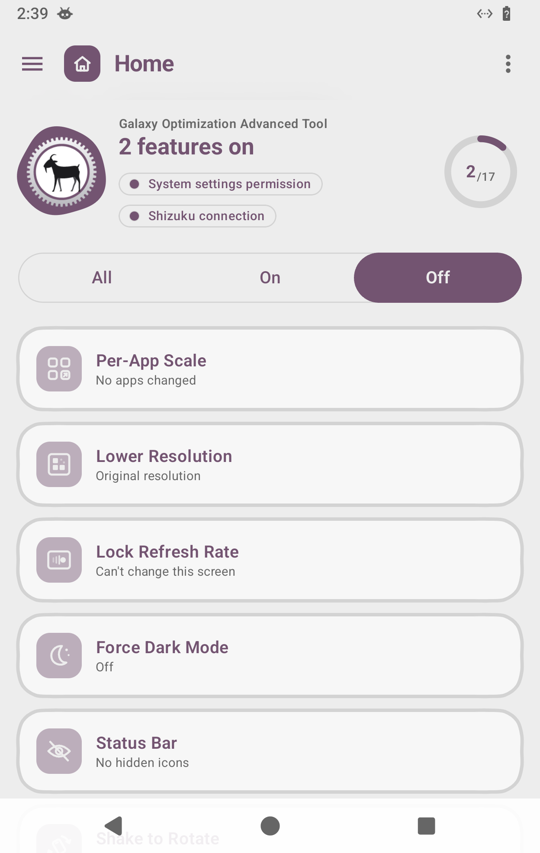
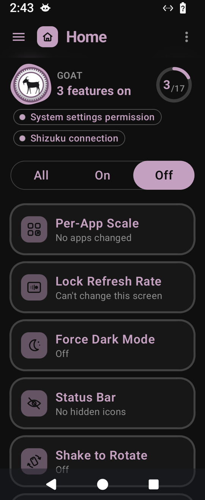
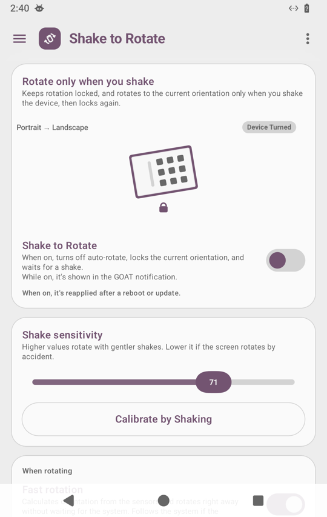
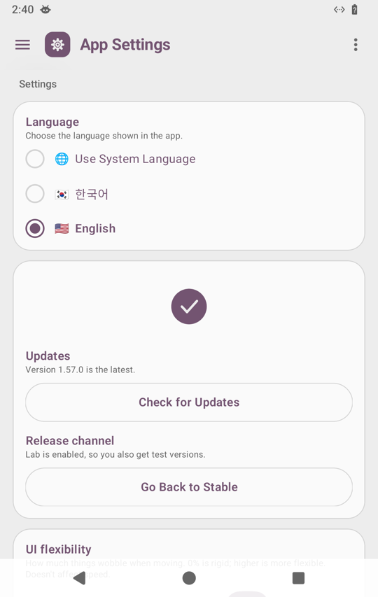

# GOAT

**🇺🇸 English** · [🇰🇷 한국어](README.ko.md)

**Galaxy Optimization Advanced Tool** — a toolbox that makes Samsung Galaxy phones nicer to use.

GOAT lets you change settings that Galaxy phones either don't offer or normally only allow through PC commands — with simple buttons and switches inside the app. No root needed, and your changes stay after a restart. Free, with no ads.

<p align="center">
  
  
  
  
</p>

## What it can do

| Feature | What it does | What you need |
|---|---|---|
| **Advanced display scale** | Makes text and icons look the same size on a Fold's cover screen and main screen. It stays that way when you fold, unfold or restart. You can also use exactly the same value on both screens. | One-time permission |
| **Per-app scale** | Makes each app bigger or smaller on its own. You can also change the current app's size right from the notification shade. | One UI 9 or later, Shizuku |
| **Lower resolution** | Lowers the screen resolution to save battery while keeping text the same size. If you don't tap "Keep" within 15 seconds, it goes back. | One-time permission (not on Fold) |
| **Lock refresh rate** | Keeps the screen always at its smoothest (e.g. 120Hz) or at 60Hz to save battery. | Shizuku |
| **Animation speed** | Makes opening and closing apps faster (or turns animations off). | One-time permission |
| **Force dark mode** | Darkens apps that don't support dark mode. | Shizuku |
| **Status bar** | Hides the whole status bar at the top, or only the icons you pick (alarm, vibrate, Bluetooth…). | One-time permission; hiding the bar needs Shizuku |
| **Shake to rotate** | Keeps rotation locked, and rotates only when you shake the phone while holding it the way you want. | One-time permission |
| **Triple-tap gesture bar to lock rotation** | Tap the center of the bottom gesture bar three times to toggle auto-rotate or rotate once and lock. Adjustable area with preview. | Display over other apps + Modify system settings |
| **Volume button rotation** | When you rotate the screen, the volume up/down buttons follow the new direction. | One-time permission |
| **Flex mode** | On Folds that don't report the half-folded state (like the Galaxy Z Fold8), standing the phone like a laptop splits YouTube, Camera and Gallery into top and bottom halves. | Fold, Shizuku |
| **Mute camera shutter** | Turns off the forced shutter sound on Korean Galaxy models so it follows silent/vibrate mode. | Shizuku |
| **App cleanup** | Turns off pre-installed apps you don't use, without deleting them. You can turn them back on any time. | Shizuku |
| **Turn off GOS** | Turns off the Game Optimizing Service that limits game performance. | Shizuku |
| **Turn off Doze** | Stops notifications from arriving late while the screen is off (uses more battery). | Shizuku |
| **Keep radios in airplane mode** | Keeps the Wi‑Fi, Bluetooth or NFC you choose on when you turn on airplane mode. | One-time permission |
| **Clipboard & TXT sharing** | Turns copied or shared text into a TXT file and sends it to another app. | Nothing |
| **Usage stats** | Shows how long your screen was on and which apps you opened most. The data never leaves your phone. | Usage access |

The app is available in English and Korean. Change it in App Settings → Language, or in Android's per-app language settings.

Experimental gesture-bar mode uses an ordinary app overlay and a user-granted system-settings permission. It does not require accessibility, privileged settings access or a running ADB/Shizuku connection. The tab includes setup buttons, adjustable width/height and area preview. Android may still request restricted-settings confirmation for sideloaded overlays. See [setup, limitations and validation](docs/gesture-bar-minimum-permissions.md).


## Getting started

1. Download the latest `GOAT-x.x.x.apk` from [Releases](../../releases/latest) and install it. The first time, you need to allow installing apps from unknown sources.
2. When you open GOAT for the first time, a **permission setup guide** appears. Just follow the steps on screen.
   - **Without a PC (recommended):** install the free app [Shizuku](https://shizuku.rikka.app/) and connect it as the guide shows. Wi‑Fi is required. If the connection drops, GOAT tells you with a notification, and its [Reconnect] button gets you back quickly.
   - **With a PC:** run the command shown in the guide once on your PC.
     ```bash
     adb shell pm grant com.labok.goat android.permission.WRITE_SECURE_SETTINGS
     ```
3. Pick a feature from Home or the left menu (☰) and turn it on.

GOAT checks for updates by itself. When a new version is out, an [Update Now] card appears at the top of Home. Uninstalling removes the permission too, so update by installing over the old version instead of uninstalling first.

## FAQ

**Is it safe?**
GOAT only changes setting values that Galaxy phones already have; it doesn't modify system files. You can undo changes with each feature's [Restore] button or Reset in the ⋮ menu.

**My screen size looks wrong. How do I undo it?**
In Advanced display scale, open the ⋮ menu → Reset → restore the default DPI. If you can't open the app, run `adb shell wm density reset` on a PC.

**Does it collect my data?**
No. Your usage data and settings stay on your phone. Only when you report a problem is a diagnostic file you chose attached to the email.

**Something isn't working.**
Open the ⋮ menu → Report a Problem. An email with a diagnostic file attached is created for you.

## What's new

See the [changelog (CHANGELOG.md)](CHANGELOG.md) for what changed in each version (in Korean and English from 1.57.1; earlier versions in Korean only).

## For developers

- Structure: a shared `:core` module, 17 feature modules `:feature:*` (display size, per-app scale, rotation, flex, …), and `:app`, which puts them together. Feature modules depend only on `:core`; a build-time check (WiringTest) enforces this.
- Build: `./build-apk.sh --release` (runs unit tests). Strings live in `core/src/main/res/values` (English, default) and `values-ko` (Korean); TranslationTest checks that every string has both languages with matching placeholders.
- Real-device testing is done on a Galaxy Z Fold8 (Android 17).

## License

Copyright (C) 2026 lala5bok

Free software released under the [GNU General Public License v3.0](LICENSE) (GPL-3.0). Anyone can use, modify and redistribute it for free. If you distribute a modified version or a program that includes this code, you must also publish that source code under GPL-3.0. A separate commercial license is available for companies or products that can't meet these terms. Contact: lala5bok@gmail.com

Libraries used: AndroidX, Jetpack Compose, HiddenApiBypass and Haze (Apache License 2.0), Shizuku-API (MIT License) — all compatible with GPL-3.0.
