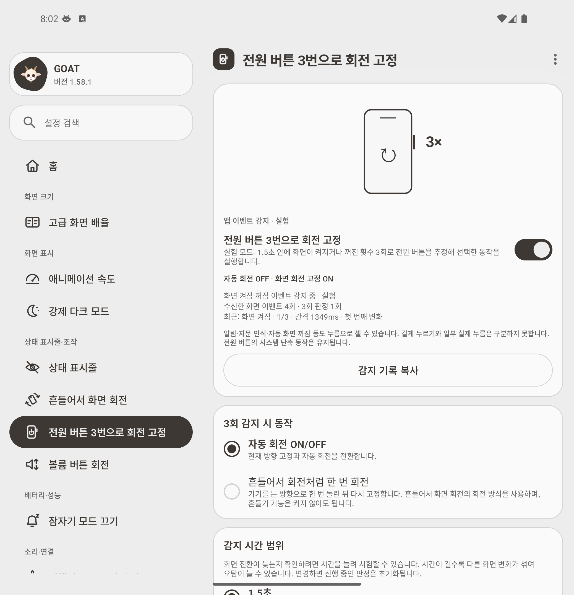
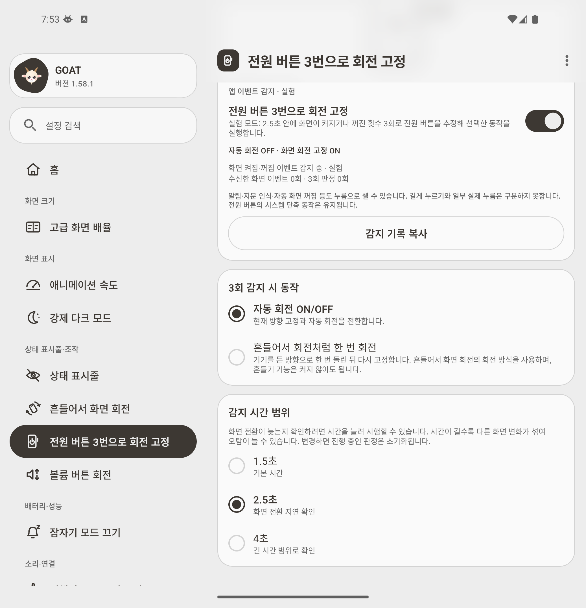

# Galaxy app-input diagnostics — preview 2

> Historical power/screen-event experiment. The current branch replaces this input with [adjustable gesture-bar triple taps](gesture-bar-rotation.md).

The contributor reports that the first app-input preview does not work on a Galaxy Z Fold8 Ultra. The device is not connected to this workspace, and no device event trace has been supplied. The cause is **unconfirmed**: event delivery, the 1.5-second limit, settings permission, rotation writes, and background-service lifetime still need to be distinguished.

This preview provides diagnosis tools inside GOAT, so gathering the relevant data does not require enabling ADB or Shizuku.

## What changed

- The original **1.5-second default is retained**. The feature screen offers 2.5- and 4-second alternatives for comparing delayed transitions. Choosing a different value cancels pending work and resets the current sequence. Longer windows can also admit more unrelated screen changes and false triggers.
- The feature screen shows received screen-event count, candidate count, last state, inter-event gap, sequence progress, and the reason for a reset or match.
- **Copy detection diagnostics** copies the current device/app/permission state plus a bounded recent history. It includes source process IDs so a restarted process can be distinguished from an uninterrupted session. The general GOAT diagnostic report includes the same section.
- An action exception is recorded and reported as a failed action rather than escaping the receiver callback. Settings-write failure details are retained in the copied report.
- Receiver history in memory is limited to 20 entries. Persistent messages use the existing 300-line app log. No polling loop, shell reader, accessibility service, or extra runtime permission was introduced.

## Collecting a device trace

1. Install this preview and open **Triple-press power to lock rotation**. Confirm that the feature is enabled.
2. Select **Auto-rotate ON/OFF** initially, to separate input recognition from one-shot orientation detection.
3. Try the failing three-press sequence. Return to the feature screen and tap **Copy detection diagnostics** (Korean: **감지 기록 복사**).
4. Share that text. If the record shows `WINDOW_EXPIRED`, compare the same sequence with the 2.5-second option and copy a second report. A longer window is a diagnostic comparison, not a guarantee that the Galaxy issue is resolved.

The report begins with `GOAT screen-input diagnostics preview2`. It records screen-event **delivery** times, not physical power-key timestamps. Opening or waking the device to copy the report can itself add another screen event; keep the full recent history when sharing it.

| Evidence | What it can establish |
| --- | --- |
| No increase in `events` during an attempt | The app did not receive additional screen broadcasts in that session. It does not identify why. |
| `WINDOW_EXPIRED` | A delivered transition arrived outside the configured window and restarted the count. |
| `DUPLICATE` | The delivered state repeated the previously observed state and did not advance the count. |
| `TRIPLE`, increased `candidates`, and an action result | A candidate reached the action callback. `actionSucceeded` describes the most recent matched candidate, not every individual press. |
| `settingsPermission=false` or `settings_write_failed` | Permission or provider failure must be investigated separately from input delivery. |
| `listener_stopped` and/or a different PID on the next `listener_started` | The listener or process was restarted. The record alone does not prove which Samsung policy caused it. |

The background restriction and process-importance fields describe the state **when the report is copied**. They cannot prove the process state at an earlier failed press. Android can [queue and coalesce context-registered broadcasts while an app is cached](https://developer.android.com/about/versions/14/behavior-changes-all#cached-broadcasts); that is a possible path to investigate, not a diagnosis of this Galaxy.

## Validation

- **235 unit tests passed; 1 existing preview test skipped.** New cases cover custom timing, explicit expiry/duplicate decisions, settings persistence, retaining a sequence across an unchanged refresh, resetting it on a timing change, bounded history, and an action exception that leaves the listener running.
- Debug compilation/unit tests and R8 release builds passed.
- On the unfolded API 36 Fold emulator, the original timing still toggled rotation without Shizuku, and a slower sequence was rejected at 1.5 seconds but accepted at 2.5 seconds.
- The actual copy button produced a report containing device permission state, `WINDOW_EXPIRED`, selected timing, a matched candidate and action success. The 4-second selection and reopening with the saved selection were also verified without a Shizuku server or input reader.
- [Runtime checks and copied emulator reports](experiments/app-level-power-input/preview2/) are retained. These are emulator evidence, **not a reproduction or resolution of the Galaxy failure**.
- Screen-event false positives and inability to distinguish long presses remain unchanged. Samsung Auto Blocker ON compatibility still requires physical-device verification.

## Screenshots

| On-device diagnostics | Optional timing comparison |
| --- | --- |
|  |  |
