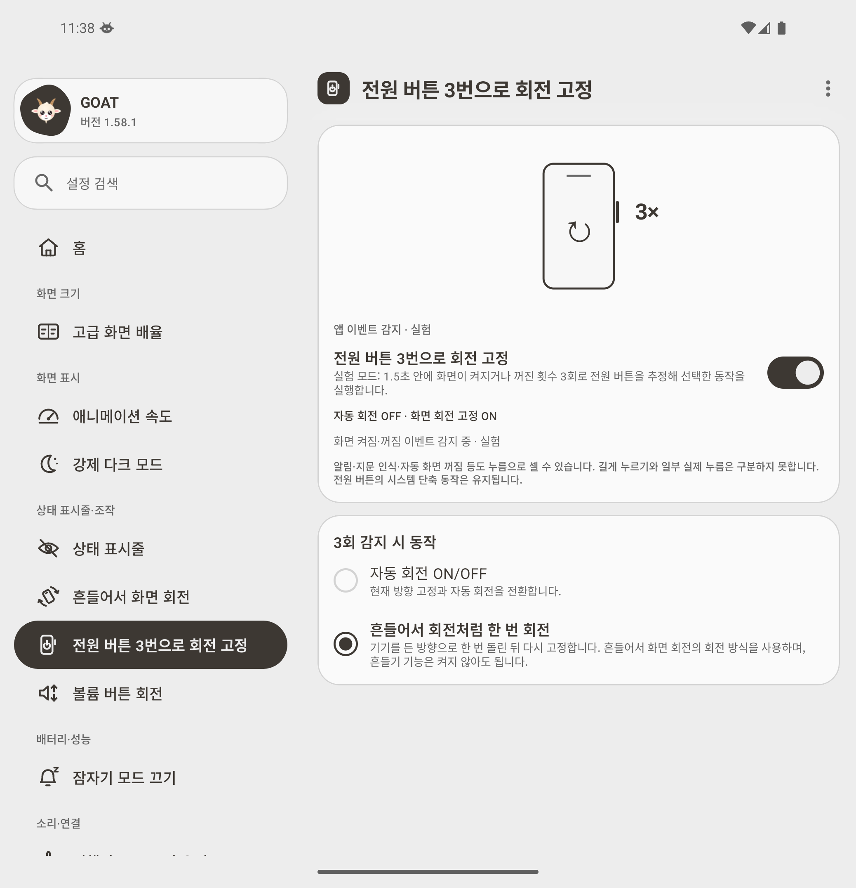

# App-level rotation shortcut experiment

The power shortcut now uses an **experimental screen-state heuristic inside GOAT**. It has no input-device reader, shell helper, local socket, or running Shizuku requirement. The one-time system-settings permission is still needed to change rotation, as for Shake to rotate.

This does **not** receive actual physical power-key events. Three alternating screen ON/OFF transitions within 1.5 seconds are interpreted as a candidate gesture. Notifications, fingerprint unlock, screen timeout, and other screen-state changes can cause false triggers. Long presses cannot be distinguished, and physical presses that do not cause the expected screen transitions can be missed. The user explicitly accepted these limitations for this experimental mode.

## Why ordinary key callbacks were not used

A separate diagnostic app tested `Activity.dispatchKeyEvent` and `AccessibilityService.onKeyEvent`. It requested key filtering, returned `false` to preserve normal key behavior, and recorded only power/volume control keys and screen-state events. It had no Shizuku, shell reader, or privileged settings permission. ADB was used only for test setup and log collection; actual emulated hardware presses were sent through the emulator controller, with kernel events recorded independently as ground truth.

| Test | Actual kernel KEY_POWER events | Activity power callbacks | Accessibility power callbacks | Volume positive control | Screen transitions / candidates |
| --- | ---: | ---: | ---: | --- | --- |
| Three power presses, foreground | 6 (DOWN/UP) | 0 | 0 | Activity 2; accessibility 2 | 3 / 1 |
| Three power presses, background | 6 (DOWN/UP) | 0 | 0 | Accessibility 2 | 3 / 1 |
| Programmatic sleep/wake/sleep, no power presses | 0 | 0 | 0 | Not used | 3 / **1 false candidate** |

The positive control establishes that accessibility key filtering was active. Android 16's [power-key policy](https://android.googlesource.com/platform/frameworks/base/+/refs/heads/android16-release/services/core/java/com/android/server/policy/PhoneWindowManager.java#5459) removes `ACTION_PASS_TO_USER` for power keys. The [accessibility input filter](https://android.googlesource.com/platform/frameworks/base/+/refs/heads/main/services/accessibility/java/com/android/server/accessibility/AccessibilityInputFilter.java#415) passes through events without that flag instead of processing them as accessibility input. This explains the observed difference between volume and power keys on this image.

[Raw diagnostic results and source](experiments/app-level-power-input/) are included for reproduction. The diagnostic app is separate from GOAT; the replacement GOAT implementation does **not** require an accessibility service.

## Replacement behavior

- The existing foreground service registers a dynamic receiver for `ACTION_SCREEN_ON` and `ACTION_SCREEN_OFF`.
- The detector initializes from the interactive state, ignores duplicate states, and resets slow or backwards-time sequences using elapsed real time.
- The two existing actions are retained: toggle auto-rotate, or reuse ShakeEngine to rotate once and lock. A short delay after a newly lit screen allows sensor samples for one-shot rotation.
- Disabling the feature unregisters the receiver and cancels pending actions. Returning to GOAT resynchronizes an enabled service, so a new shell bootstrap is unnecessary after reopening the app.
- Korean and English UI/help/notification text explicitly identify app-event detection as experimental and describe the false-positive and long-press limitations. The original cards, switch, radio controls, and power-button icon are retained.

## Validation

Test environment: visible, unfolded Pixel 9 Pro Fold API 36 emulator; R8 release build; wireless-debugging flag OFF; Shizuku server absent; no `getevent` process; accessibility disabled during GOAT validation. Host ADB remained available for observation.

- **228 unit tests passed; 1 existing preview test skipped.** Tests cover the transition window, duplicates, initial screen states, elapsed-time reset, known non-power ambiguity, missing settings permission, receiver shutdown, and cancellation of delayed one-shot work.
- Debug compilation/unit tests and the R8 release build passed. APK signature verification passed with the same key as earlier custom previews.
- Single/double transitions and slow sequences did not toggle rotation in the emulator cases tested.
- Three actual emulated power presses toggled auto-rotate in both directions in the background, including a sequence starting with the screen off.
- One-shot landscape and portrait rotation passed with shake detection disabled.
- Feature OFF ignored subsequent transitions. After force-stop and reopening GOAT, detection resumed without Shizuku.
- A programmatic sleep/wake/sleep sequence with no physical power presses also toggled rotation: the known false-positive limitation was reproduced, not excluded from the results.
- The emulator shell could not stop the non-exported service in isolation, so that separate lifecycle fixture was skipped. Process-restart recovery was tested; service-only recovery is implemented through activity resume but was not independently demonstrated by that fixture.

[Runtime results](experiments/app-level-power-input/rotation-runtime-results.json) include both successful functional checks and the explicitly labeled known false positive.

## Samsung Auto Blocker boundary

The contributor reports that enabling Auto Blocker stops background operation while the GOAT UI still opens. [Samsung documents USB-command blocking](https://www.samsung.com/us/support/answer/ANS10003636/). Device logs have not established exactly which component of the earlier shell-based path was terminated.

The AOSP emulator has no Samsung Auto Blocker implementation. Removing GOAT's shell-input dependency is verified here; operation with **Auto Blocker ON on a physical Galaxy is still unverified**. This preview must not be presented as a confirmed fix for all Samsung background or security policies.

The earlier [one-hour observation was interrupted](measurements/2026-11-12-background-interrupted.md) at the user's request. It measured the previous shell implementation and is not a battery benchmark for this replacement.

## Screenshots

| Toggle auto-rotate | Rotate once, then lock |
| --- | --- |
|  |  |
