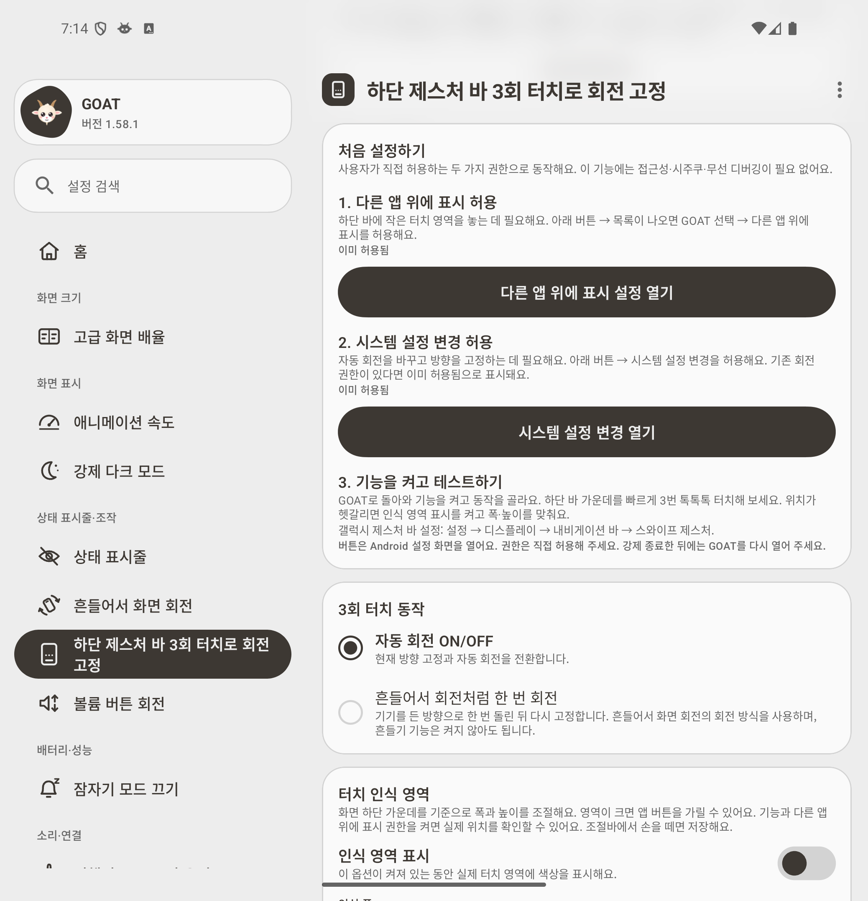
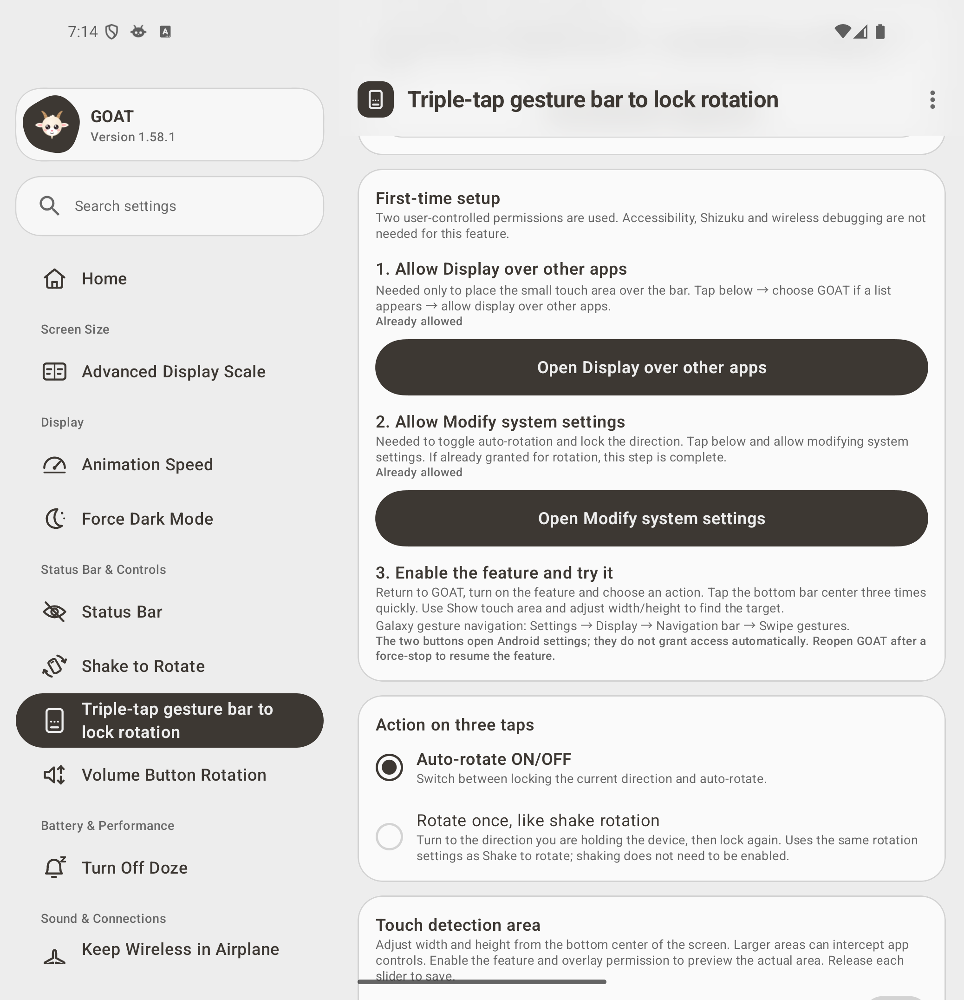
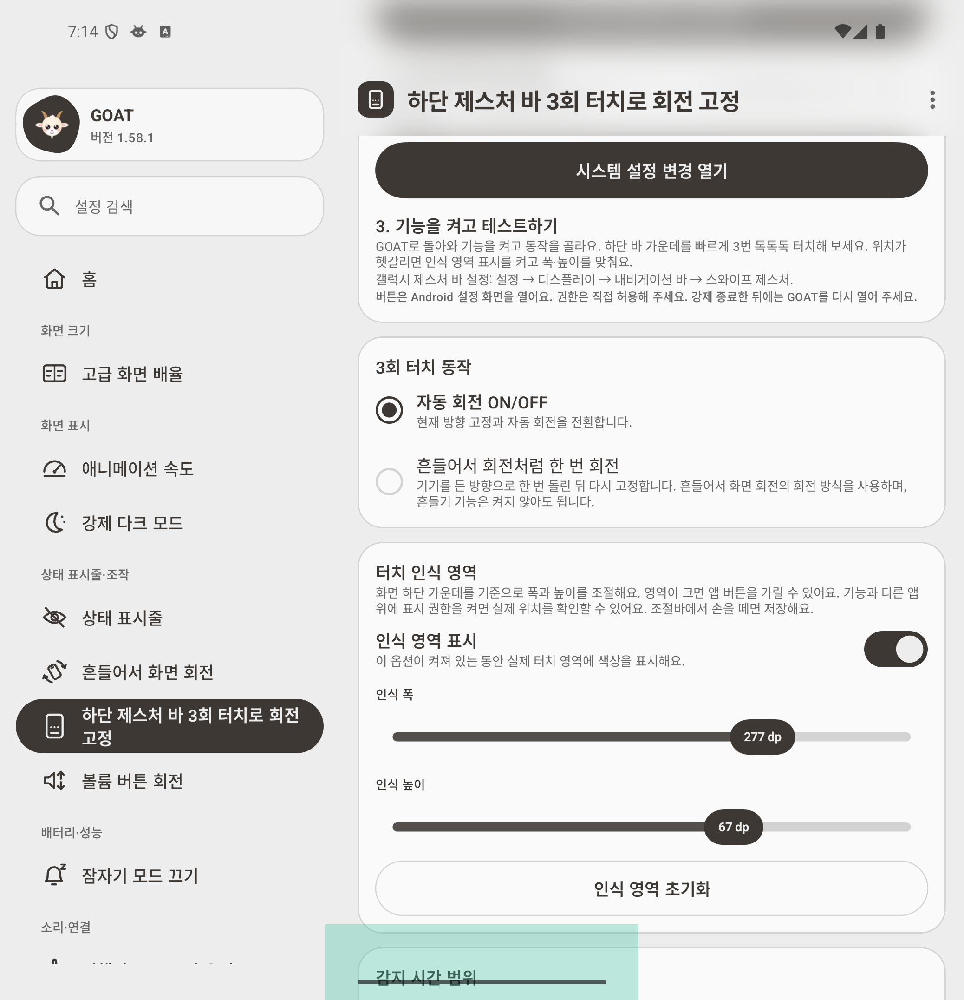

# Gesture-bar rotation with reduced permissions

The gesture-bar input no longer uses an accessibility service. A small ordinary `TYPE_APPLICATION_OVERLAY` is owned by GOAT's existing foreground service. Only touches delivered to that window are processed. The existing `TripleTap` policy and both rotation actions are retained.

## Required access

| Access | Purpose | How it is granted |
| --- | --- | --- |
| Display over other apps (`SYSTEM_ALERT_WINDOW`) | Place the small touch target over the gesture bar | Android's special-access settings, opened by a button in the feature tab |
| Modify system settings (`WRITE_SETTINGS`) | Write `accelerometer_rotation` and `user_rotation` | Android's special-access settings, opened by a second button |

This feature does not require accessibility, `WRITE_SECURE_SETTINGS`, root, a running Shizuku process or a runtime ADB connection. A previously granted `WRITE_SECURE_SETTINGS` permission is accepted for compatibility; it is not requested by this feature. Other GOAT tools still use their existing permissions and accessibility components. The shared shake engine accepts the ordinary system-settings grant for one-shot rotation; its secure-only settings controls continue to require their original privileged grant.

The feature's accessibility service and its metadata XML are removed from the manifest. The foreground service owns registration, screen-state broadcasts, display changes and overlay cleanup. It hides the target on sleep/lock, repositions after rotation/folding/size changes, resets tap sequences when the target changes, stops on missing/revoked access and resumes when the user returns with permission. No polling loop, global input subscription or wake lock is introduced. The one-shot orientation sensors run only when their action is selected and both required accesses are available.

## Setup

The tool tab explains three steps in Korean and English:

1. Allow **Display over other apps**.
2. Allow **Modify system settings** (or retain an existing rotation grant).
3. Enable the feature, choose an action and tap the bottom bar three times. Preview/resize the touch area if needed.

The app opens Android settings; it cannot grant permissions automatically. The app-info recovery button remains available if permissions are missing. **Android 16 can still require “Allow restricted settings” for sideloaded overlays and may apply that confirmation to other special accesses.** This implementation reduces privileges; it does not suppress Android's permission confirmation or overlay warnings. See the [Android 16 compatibility requirements](https://source.android.com/docs/compatibility/16/android-16-cdd) and [system-settings access API](https://developer.android.com/reference/android/provider/Settings.System#canWrite(android.content.Context)).

## Platform limits

Ordinary overlays sit below critical system windows. Apps can hide them, keyboards may cover them, and OEM navigation bars can intercept touches. Larger targets can interfere with app controls. The prototype received actual bottom-bar taps and preserved the home swipe on the API 36 Fold emulator with accessibility completely off; this does not establish the same behavior for every Samsung configuration. The existing width/height controls and optional area preview remain available.

## Validation

- **236 unit tests passed; 1 existing preview test skipped.** New cases cover normal settings access without a secure grant, retention of secure-only controls, overlay revocation and fresh sequence recovery. Existing detector, rotation, spacing and localization checks passed.
- Debug and R8 release builds passed. The final release build passed in 1m 13s after the last compatibility adjustment. APK signature verification matched the previous Arc-Jung preview key.
- **24 runtime checks plus 2 UI checks passed on the final release APK** on the visible API 36 Fold emulator. Accessibility was disabled and its enabled-service list empty; GOAT's `WRITE_SECURE_SETTINGS` grant was revoked. Only the ordinary overlay and normal system-settings accesses were allowed. Shizuku/input readers were stopped; host ADB was used for installation, grant/revoke fixtures and test inspection, not by the feature.
- Verified background triple taps, both rotation toggles, home swipe, outside/held touches, revocation/regrant of both accesses, one-shot landscape/portrait followed by lock, sleep/unlock, fold/unfold, enable/disable, width/height resizing, visible area preview and Korean/English setup.
- The default 180 × 24 dp area used 438 × 58 px on the inner display; 277 × 67 dp used 675 × 163 px. The folded display received real raw touch events at its own centered bottom target. Input coordinates were transformed to native panel axes for the landscape test.
- [Raw checks, copied diagnostics, ordinary-overlay prototype and APK verification](experiments/gesture-bar-minimum-permissions/) are retained. These are emulator results; **physical Samsung behavior and Auto Blocker compatibility remain unverified for this new implementation**.
- Historical accessibility-based results remain in [the earlier gesture-bar notes](gesture-bar-rotation.md) and are not evidence for this implementation.

## Screenshots

| Korean permission/setup page | English permission/setup page |
| --- | --- |
|  |  |

