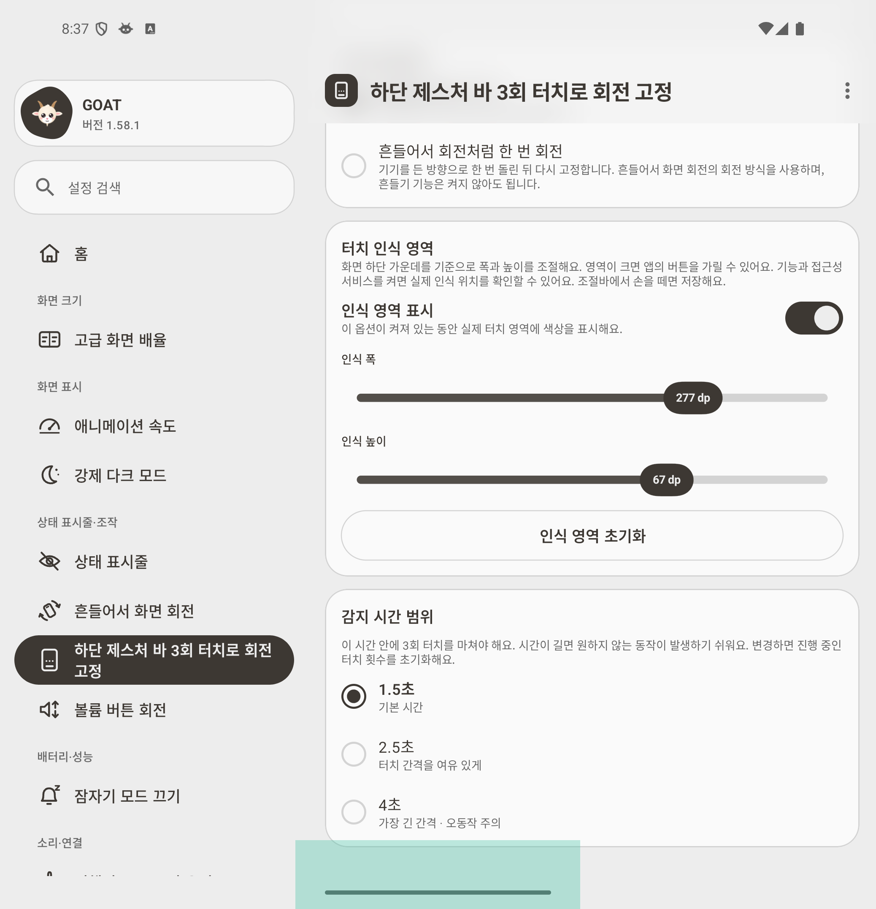
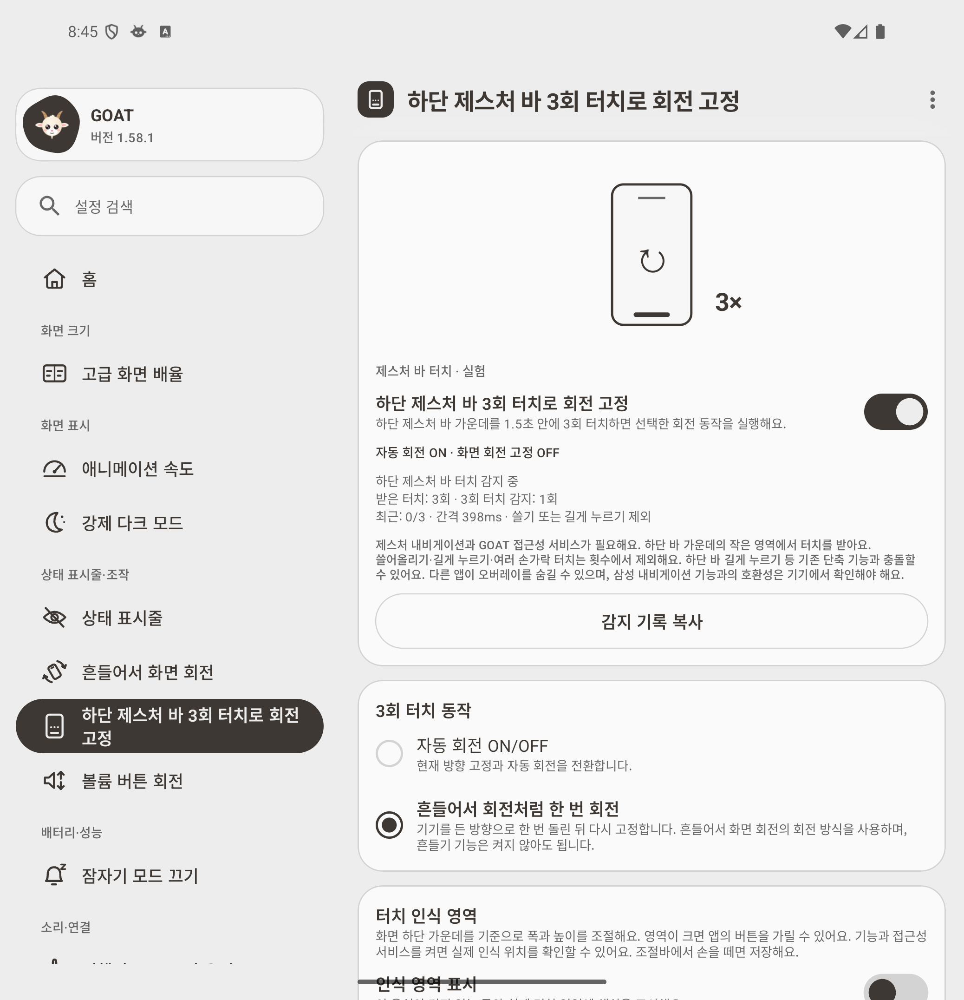
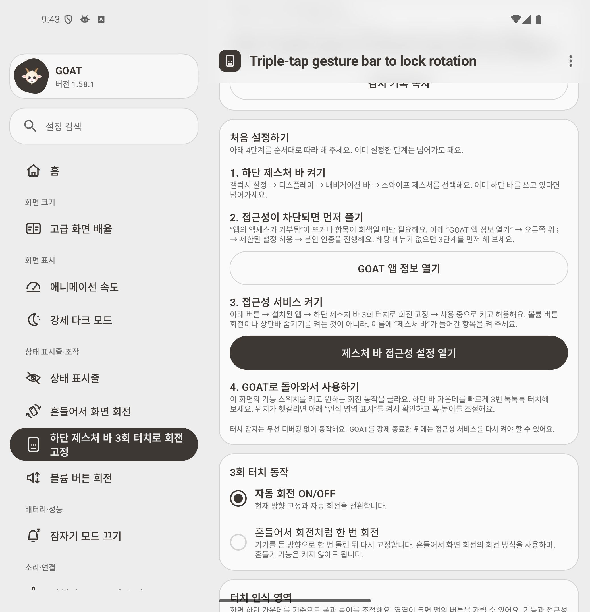
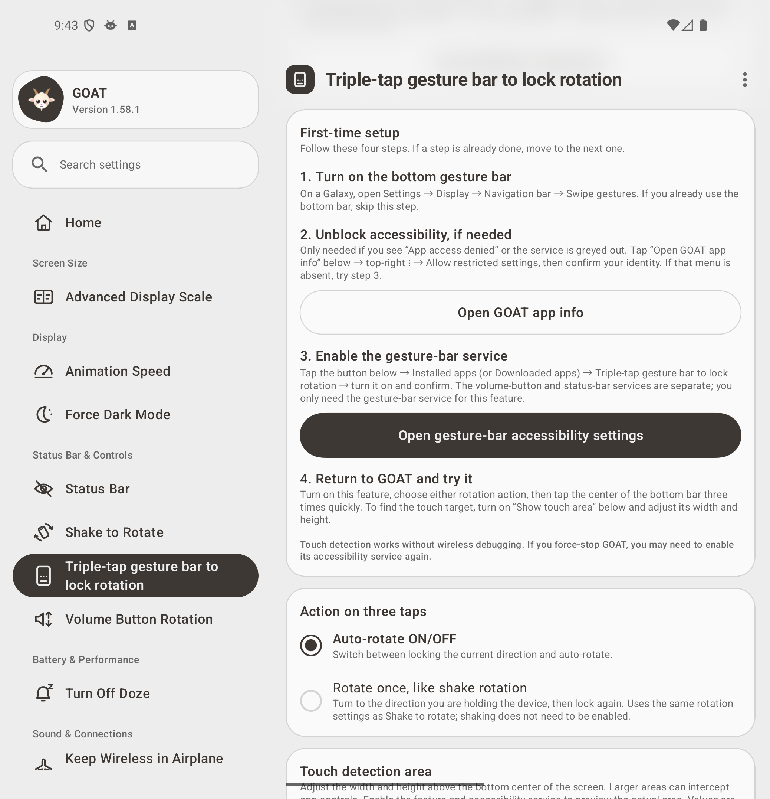

# Gesture-bar triple-tap rotation (experimental)

Replaces the power-button/screen-transition experiment at the contributor's request. Triple-tap the **center of the bottom gesture bar** to either toggle auto-rotation/current-direction lock or rotate once using the existing ShakeEngine and lock again. Shaking itself can stay disabled. The dedicated tool screen, menu icon, help, status, search labels and both English/Korean strings follow the existing GOAT controls.

## App-level input

A dedicated `GestureBarService` uses `TYPE_ACCESSIBILITY_OVERLAY` for a small touchable window centered at the physical bottom of the default display. The default area is **180 × 24 dp**. Width (48–360 dp), height (8–96 dp), a colored area preview and reset are available on the feature screen. Settings are saved after releasing a slider and survive reopening. Resizing clears pending taps and rebuilds only the overlay. Enlarging it can intercept application controls; preview displays the actual active input area, including over other apps.

Enable gesture navigation, grant the existing rotation settings permission once, enable this feature, and explicitly enable GOAT's gesture-bar accessibility service in Android Accessibility settings. Some sideloaded installs require **App info → menu → Allow restricted settings** first. Input detection and resizing do **not** execute ADB/shell commands or require a running Shizuku process. The existing one-time settings permission may still need GOAT's permission guide/Shizuku setup. Do not interpret app-level input as removal of the permission needed to change rotation.

The tool tab also contains **First-time setup / 처음 설정하기**, a four-step guide: enable gesture navigation, unblock restricted settings only if denied, enable the specifically named gesture-bar accessibility service, then return to GOAT to choose an action and test. **Open GOAT app info** opens GOAT's own Android app-info screen, and the accessibility button opens Android Accessibility settings. Both buttons only navigate; they do not grant permissions. The guide stays available after setup and offers the existing rotation-permission guide when that permission is missing. Korean and English text are provided.

The setup paths follow [Android’s restricted-settings instructions](https://support.google.com/android/answer/12623953?hl=en) and [Samsung’s gesture-navigation instructions](https://www.samsung.com/us/support/answer/ANS10002427/).

The contributor subsequently reported that the feature works on their Galaxy after allowing restricted settings. This is user-reported confirmation; it does not independently verify every Samsung security mode or navigation shortcut.

The accessibility service does not retrieve screen content, request key filtering, use touch exploration, subscribe to every touchscreen event, poll, hold a wake lock, or request system-gesture exclusion. Only touch events delivered to its own small overlay are processed. The old screen ON/OFF rotation trigger is removed; screen broadcasts only hide/recreate the overlay across sleep/unlock. The common foreground service and accessibility connection coordinate lifecycle without a shell input reader.

Three completed single-finger taps must fit within the selected 1.5/2.5/4-second window. Moving past Android's touch slop, holding for the long-press timeout, multiple pointers, system cancellation, screen state/configuration changes and area resizing break the sequence. Disabling the feature removes its touch area. Force-stopping the app can remove the service from Android's enabled accessibility list; re-enable it in Accessibility settings after reopening. Revoking rotation permission prevents the action. Diagnostic history is bounded and can still be copied from the app.

## Platform constraints

Android does not offer an ordinary app a passive listener for SystemUI's gesture handle. This implementation **receives touches through an overlay**, rather than identifying physical taps on Samsung's SystemUI view. System gesture monitors can cancel its touch stream for home navigation; no swipe is converted into a tap. Existing bar long-hold shortcuts, Circle to Search, Samsung taskbar behavior, immersive apps and apps hiding overlays can differ by device. This remains an experiment until tested on the user's Galaxy. It is inactive with three-button navigation and hides on the lock screen/screen off. Enlarging the area is a user choice, not a claim that every covered app control remains usable.

The Android API specifically states that [sources requested through `setMotionEventSources` are not sent to the rest of the system](https://developer.android.com/reference/android/accessibilityservice/AccessibilityService#onMotionEvent(android.view.MotionEvent)); that global interception path is not used. [Accessibility overlays](https://developer.android.com/reference/android/view/WindowManager.LayoutParams#TYPE_ACCESSIBILITY_OVERLAY) provide the local window used here.

## Verification

- **233 unit tests passed; 1 existing preview test skipped.** Coverage includes swipe/hold/cancel/clock/timing boundaries, rotation actions, permission revocation, settings persistence and area limits. The repository spacing/localization checks passed.
- Debug and R8 release builds passed (`BUILD SUCCESSFUL`, 2m 4s), and APK signature verification matched the previous Arc-Jung preview key.
- Tested the **actual release APK** on a visible unfolded Pixel 9 Pro Fold API 36 emulator, with Shizuku and input readers stopped and wireless debugging disabled. Host ADB remained available for installation, state inspection and test automation; the app's input code does not use it.
- Real emulator hardware touch events toggled rotation, including while GOAT was behind the launcher. Home swipe reached the launcher and cancelled pending taps. Outside-area taps and long holds did not trigger rotation; power/screen transitions no longer triggered it.
- The sliders changed the default **180 × 24 dp (438 × 58 px)** area to **277 × 67 dp (675 × 163 px)**. A point outside the original area worked in the enlarged area while the app was in the background. The copied report retained both dimensions and preview state after returning. Reset restored the default physical bounds.
- One-shot rotation reached landscape and then portrait and locked both directions. Raw gRPC touches require transformation from logical coordinates to native panel axes after rotation; the initial harness mismatch and investigation report are retained separately. Corrected touches passed without changing the app.
- Screen off removed the overlay. After folding and waking, the overlay was centered on the 1080 × 2424 outer display and remained usable. Unfolding restored its 2076 × 2152 inner-display position. Disabling the feature removed the window; re-enabling restored it without Shizuku.
- [Raw runtime checks, copied diagnostics, coordinate investigation and unit-test summary](experiments/gesture-bar-input/) are retained. These are emulator results, **not physical Galaxy Fold8 or Samsung Auto Blocker verification**.

## Screenshots

| Rotation actions and status | Adjustable touch area and preview |
| --- | --- |
|  |  |

## Setup-guide follow-up

The in-app four-step guide was checked on the actual updated release APK. All **6 existing spacing/localization checks** passed, the R8 release build passed, and the APK certificate matched preview 1. **6 emulator checks** confirmed Korean instructions, GOAT-specific app-info navigation, accessibility-settings navigation, final usage/area guidance, equivalent English instructions and continued triple-tap operation after returning from settings. See the [follow-up results](experiments/gesture-bar-input/setup-guide/).

| Korean setup guide | English setup guide |
| --- | --- |
|  |  |
